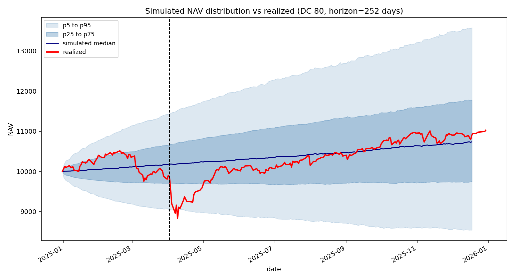
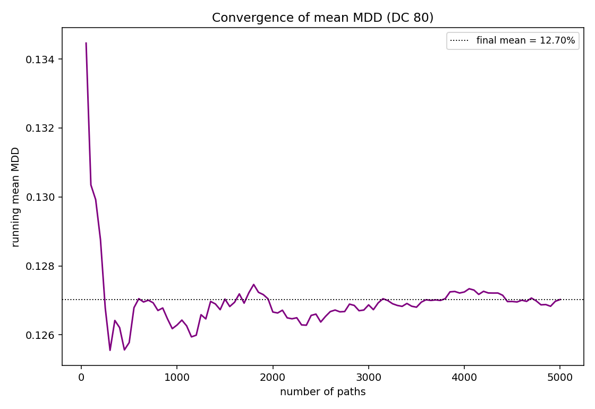
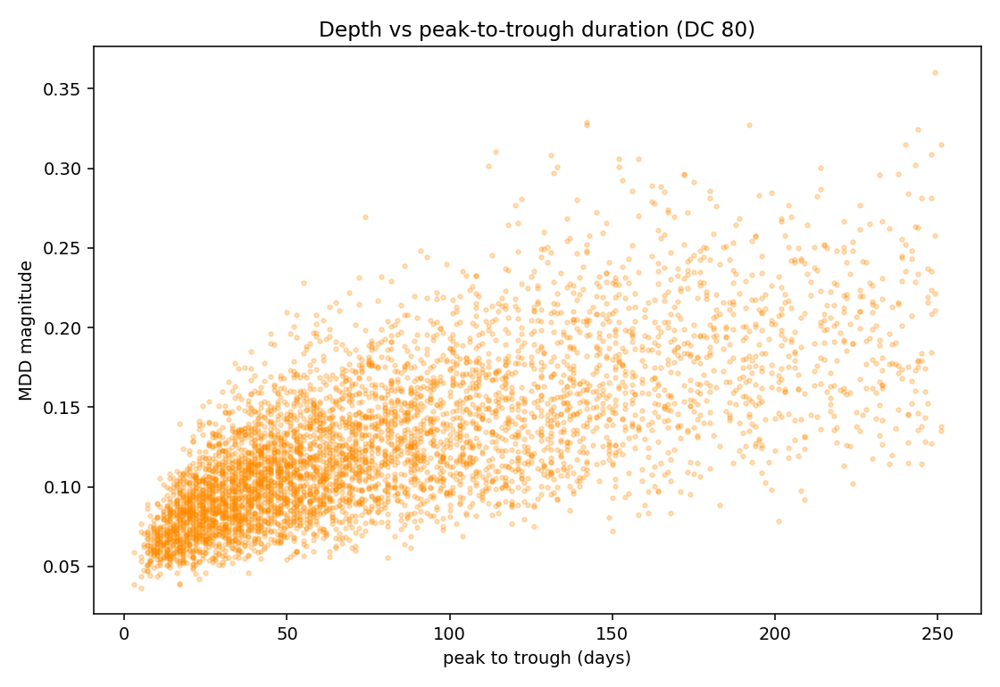
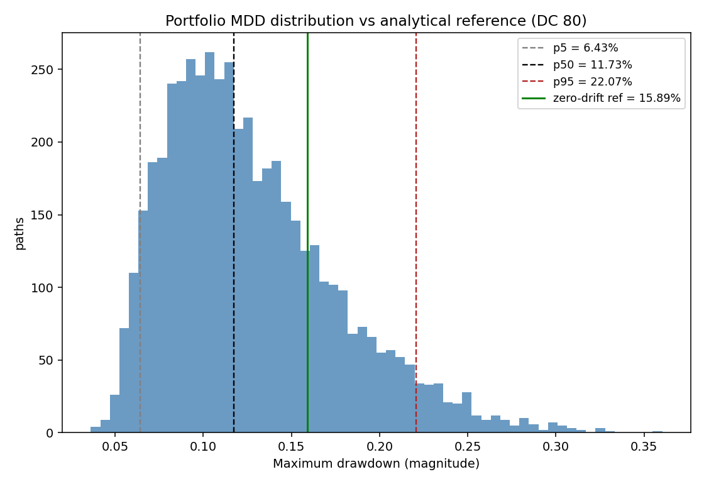
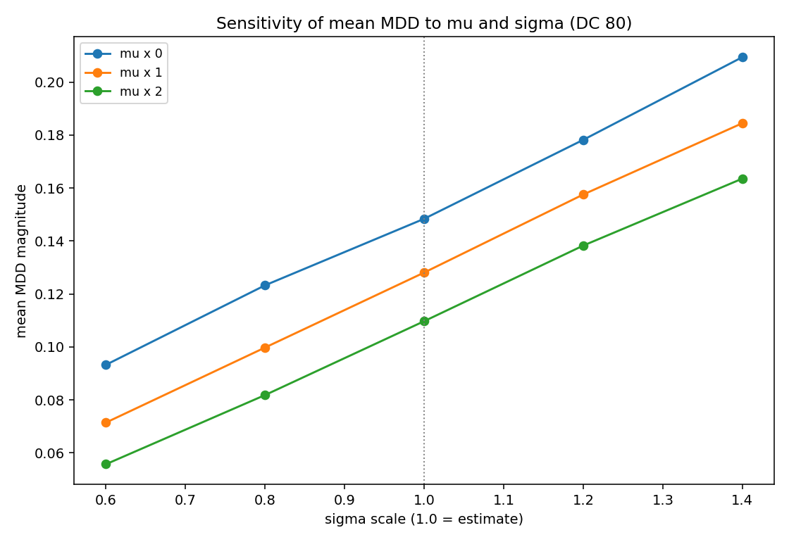
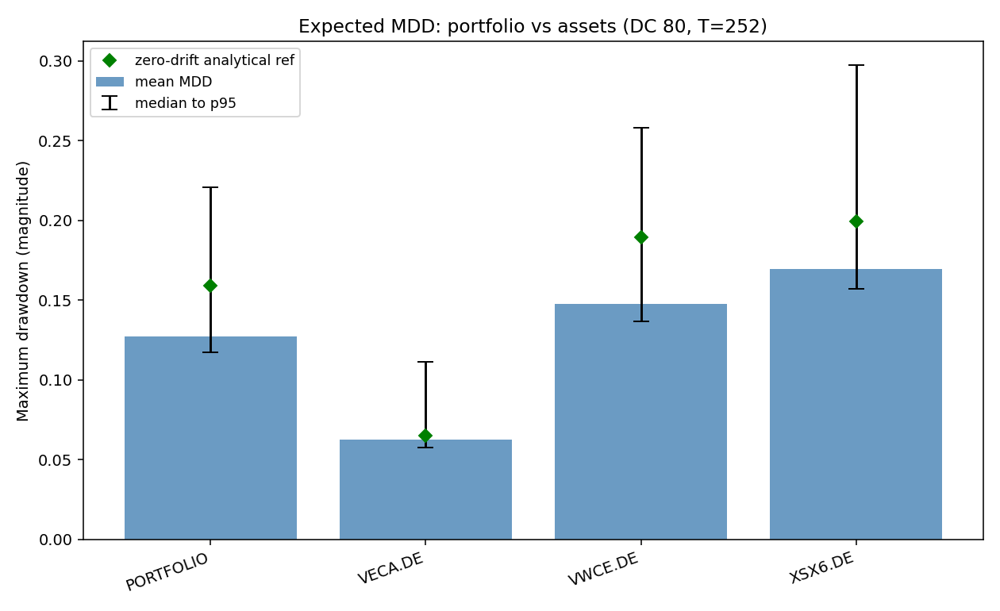

# Quantitative Portfolio Management and ETF Analysis

A Python-based quantitative investment framework for portfolio construction, risk analysis, ETF screening and Monte Carlo simulation.

## Project Overview

This project implements a quantitative investment framework designed to analyse ETFs, construct investment portfolios, evaluate portfolio risk and performance, and simulate potential future outcomes.

The framework combines financial data processing, quantitative investment strategies, portfolio risk assessment and Monte Carlo simulations to support quantitative investment analysis.

The analysis uses historical market data to evaluate portfolio behaviour, compare investment strategies and investigate potential future risk scenarios.

## Main Features

### Portfolio Construction
- Implementation of five portfolio management strategies.
- Portfolio allocation and daily position updates.
- Calendar-based and drift-based rebalancing.
- Portfolio and benchmark tracking.

### Risk and Performance Analysis
- Ex-ante and ex-post risk and performance evaluation.
- Sharpe ratio, volatility and beta.
- Value at Risk (VaR) and Conditional Value at Risk (CVaR).
- Tracking error and portfolio risk contribution.

### ETF Screening
- ETF eligibility filtering.
- Analysis of expense ratios, liquidity and tracking characteristics.
- Quantitative scoring and ranking.
- Asset classification and allocation.

### Monte Carlo Simulation
- Correlated Geometric Brownian Motion simulations.
- Portfolio value projections.
- Maximum drawdown analysis.
- Sensitivity and convergence analysis.

## Project Structure

The project is organized into seven Python modules, each responsible for a specific component of the quantitative investment framework.

```text
quantitative-portfolio-management/
│
├── main.py
├── dataprep.py
├── portfolio.py
├── ex_ante.py
├── ex_post.py
├── monte_carlo.py
├── etf.py
│
├── file2.xlsx
├── README.md
└── requirements.txt
```

| Module | Description |
|---|---|
| `main.py` | Main script coordinating the execution of the different modules and analysis workflows. |
| `dataprep.py` | Retrieves and processes financial market data, calculates returns and prepares the inputs required for portfolio analysis. |
| `portfolio.py` | Implements portfolio construction strategies, asset allocation, rebalancing and portfolio tracking. |
| `ex_ante.py` | Calculates prospective portfolio risk and performance metrics. |
| `ex_post.py` | Evaluates realized portfolio performance and risk using historical data. |
| `monte_carlo.py` | Performs Monte Carlo simulations to analyse potential portfolio outcomes and risk scenarios. |
| `etf.py` | Implements ETF screening, eligibility filtering, scoring and ranking. |

**Configuration file**

- `file2.xlsx`: Excel workbook containing the ETF information and configuration parameters used by the framework.


## Methodology

### Portfolio Management Strategies

The framework implements five portfolio management strategies:

- **Buy and Hold:** Maintains the initial portfolio allocation without systematic rebalancing.
- **Naive Risk Parity:** Allocates capital according to the inverse volatility of each asset.
- **Volatility Targeting:** Adjusts portfolio exposure to achieve a predefined volatility target.
- **Calendar Rebalancing:** Rebalances portfolio weights at predefined time intervals.
- **Drift Rebalancing:** Rebalances the portfolio when asset weights deviate beyond specified thresholds.

### Risk and Performance Metrics

The framework combines ex-ante and ex-post evaluation methods.

- **Ex-ante analysis:** Estimates prospective risk and performance using expected returns and risk measures, including volatility, Sharpe ratio, beta, VaR and CVaR.
- **Ex-post analysis:** Evaluates realized performance through historical returns, drawdowns, volatility, alpha, beta and tracking error.
- **Risk contribution:** Examines the contribution of individual assets to overall portfolio risk using Marginal Contribution to Risk (MCR) and Component Contribution to Risk (CCR).

### ETF Screening

ETFs are evaluated through eligibility criteria and quantitative scoring. The screening process considers characteristics such as expense ratios, liquidity, tracking performance and risk-related indicators.

### Monte Carlo Simulation

Future portfolio outcomes are modelled using correlated Geometric Brownian Motion (GBM). The simulations are used to study potential NAV trajectories, drawdown depth and duration, recovery behaviour, and sensitivity to modelling assumptions.

## Requirements
numpy
pandas
yfinance
matplotlib
scipy
statsmodels
openpyxl

## How to Run

### 1. Clone the repository

```bash
git clone https://github.com/bealima05/quantitative-portfolio-management.git
cd quantitative-portfolio-management
```

### 2. Install dependencies

```bash
pip install -r requirements.txt
```

### 3. Configure the input data

Ensure that `file2.xlsx` is available in the project root directory, as it contains the ETF information and configuration parameters required by the framework.

### 4. Run the project

Execute the main script:

```bash
python main.py
```

The framework will process the input data, perform the selected portfolio analyses and generate the corresponding outputs.

## Outputs

## Research Paper

The project was developed as a scientific and consultancy project at Instituto Superior Técnico, in collaboration with Dolat Capital Gestão Indexada.

[Read the full research paper (PDF)](paper/quantitative_model_etf_portfolio_analysis.pdf)

## Results and Visualizations

### Monte Carlo Simulation

The Monte Carlo framework uses correlated Geometric Brownian Motion (GBM) to simulate potential portfolio outcomes and assess portfolio risk.

**Simulated vs. Realized Portfolio Performance**



**Simulation Convergence**



**Maximum Drawdown Depth vs. Duration**



**Maximum Drawdown Distribution**



**Sensitivity Analysis**



**Portfolio vs. Individual Assets**


